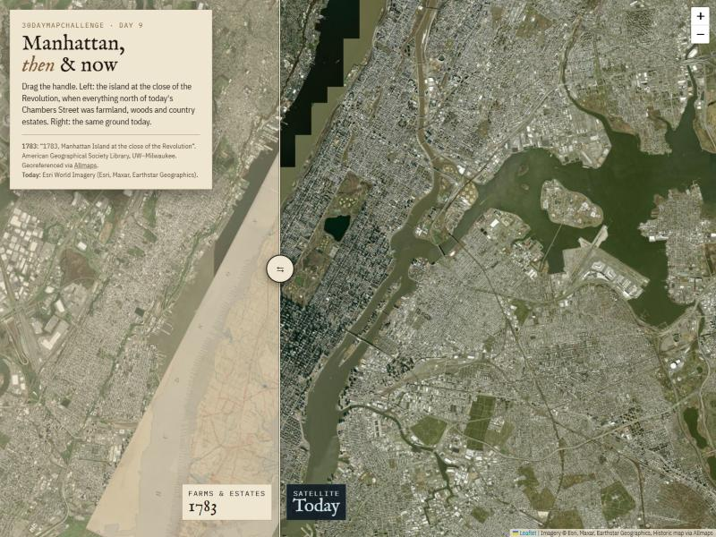

# Manhattan, then & now

**#30DayMapChallenge · Day 9**

An interactive swipe map comparing Manhattan in **1783**, at the close of the American Revolution, with the island **today**. In 1783 everything north of the small city at the southern tip was farmland, woods and country estates.

Drag the handle to move between the two. Arrow keys work too.

## View it

**Live map:** https://hasanemirbicen-dotcom.github.io/manhattan_island_urban_rural1783/

You can also download `index.html` and open it in a browser.

It is a single HTML file with no build step. It needs an internet connection, because the map tiles load from the sources below.

## Data

| Layer | Source |
|---|---|
| 1783 map | *1783, Manhattan Island at the close of the Revolution*. American Geographical Society Library, University of Wisconsin–Milwaukee. Georeferenced tiles served by [Allmaps](https://allmaps.org) (map id `71ffdd4e9d16e3a2`). |
| Today | Esri World Imagery (Esri, Maxar, Earthstar Geographics). |

## Built with

- [Leaflet](https://leafletjs.com) 1.9.4
- [Allmaps](https://allmaps.org) tile server for the georeferenced historic map
- Fonts: IM Fell English, IBM Plex Sans Condensed and IBM Plex Mono (Google Fonts)

## Note on alignment

The historic map is georeferenced with a small number of control points. It lines up well at island scale, but individual streets and shorelines can be off by a block or so.
